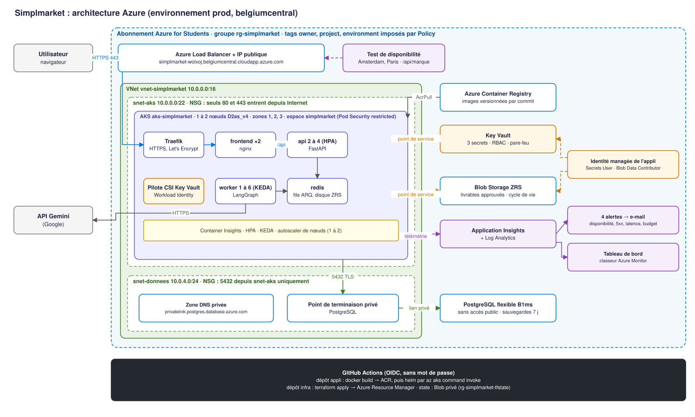
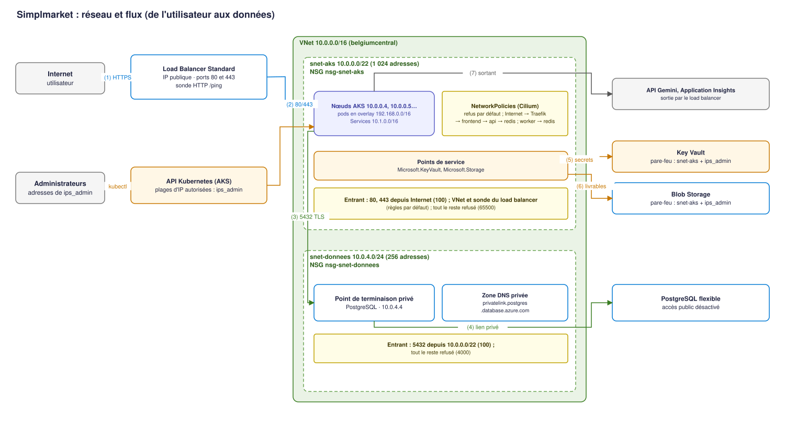
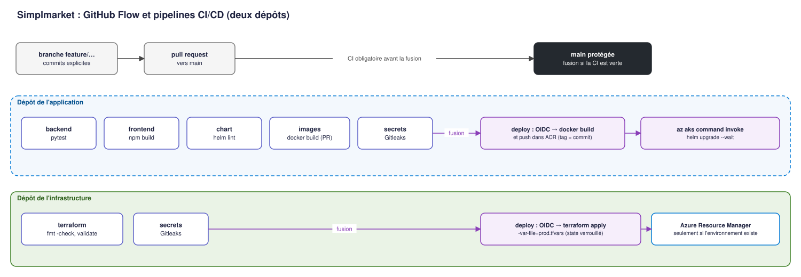
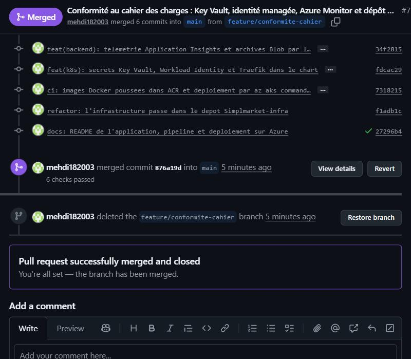
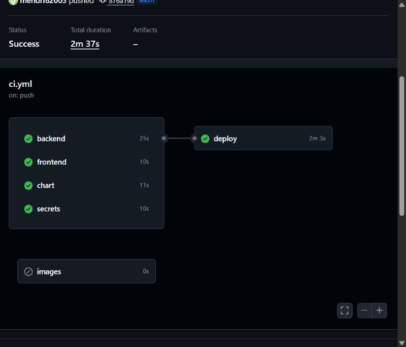
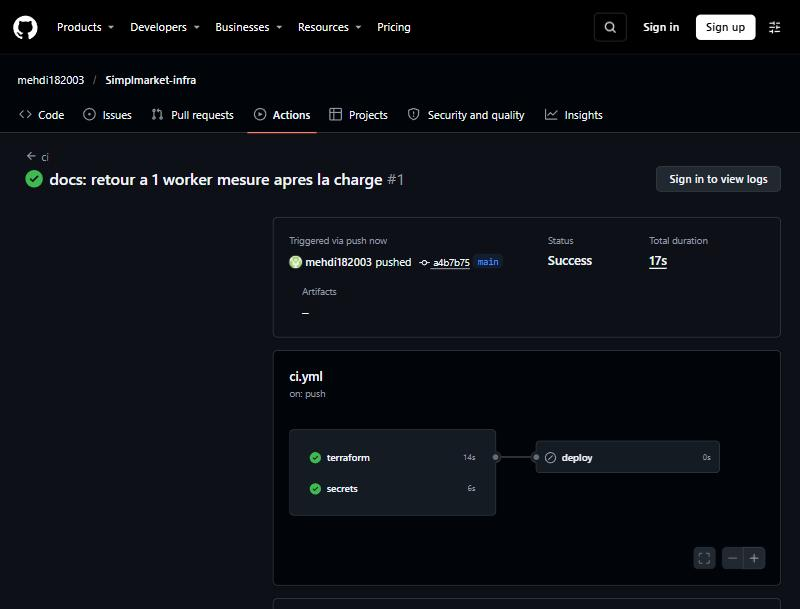
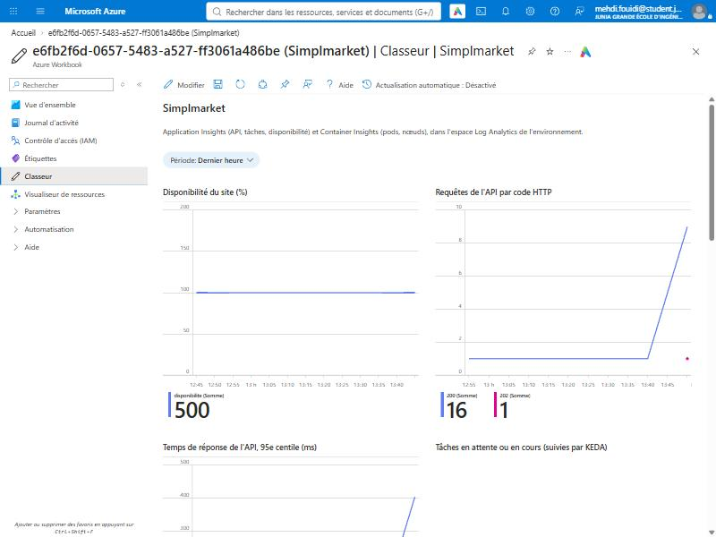
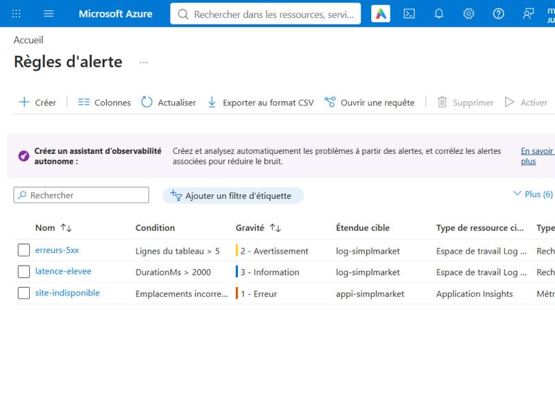

# Simplmarket sur Azure : rapport de rendu

Projet de Cloud Computing, Junia, décembre 2026.

| | |
|---|---|
| Dépôt de l'application | <https://github.com/galile0-24/Simplmarket> |
| Dépôt de l'infrastructure (ce dépôt) | <https://github.com/mehdi182003/Simplmarket-infra> |
| Application en ligne | <https://simplmarket-wolxoj.belgiumcentral.cloudapp.azure.com> |
| Abonnement | Azure for Students, région `belgiumcentral` |

Les schémas sont des fichiers draw.io (`docs/diagrammes/*.drawio.svg`). Ils s'affichent comme des images et s'ouvrent
tels quels dans draw.io pour être modifiés.

## 1. Contexte et objectifs

### L'application

Simplmarket est une **agence marketing animée par des agents IA**. Une PME y décrit son besoin dans une interface de
chat : « rédige la newsletter de novembre », « audite notre site », « prépare une campagne LinkedIn »… Un
**superviseur** confie la demande à l'un des six agents spécialisés : contenu, SEO, publicité, veille, réseaux
sociaux ou reporting. L'agent produit le livrable, puis un agent de **relecture** le vérifie. Le profil de la marque
(cible, ton, concurrents) sert de contexte à chaque agent. Un livrable **approuvé** par l'utilisateur est archivé.

Les agents appellent le modèle Gemini (offre gratuite). Une tâche dure de 10 secondes à plusieurs minutes : elle ne
peut donc pas être traitée pendant la requête HTTP. L'API la met en file, et des **workers** l'exécutent étape par
étape, en enregistrant chaque étape dans la base. Cette contrainte structure toute l'architecture.

### Objectifs

| Objectif | Traduction technique |
|---|---|
| Disponible sur Internet, en HTTPS | Load Balancer Azure, point d'entrée Traefik, certificat Let's Encrypt |
| Absorber des pics de demandes sans payer pour rien | Trois niveaux d'élasticité : API (HPA), workers (KEDA), nœuds (autoscaler) |
| Résister aux pannes | Plusieurs réplicas, reprise d'une tâche après la perte d'un worker, disques ZRS |
| Aucun secret dans le code, accès au moindre privilège | Key Vault, identité managée, RBAC, réseau fermé par défaut |
| Tout recréer à l'identique, sans clic dans le portail | Terraform pour l'infrastructure, Helm pour Kubernetes, CI/CD GitHub Actions |
| Savoir ce qui se passe | Azure Monitor : Application Insights, Container Insights, alertes, tableau de bord |
| Coût minimal sur un crédit étudiant | Plus petites tailles autorisées, environnement détruit hors des séances |

### Contraintes de l'abonnement Azure for Students

Elles ont été mesurées en déployant, et expliquent plusieurs choix :

- **5 régions autorisées** : `francecentral`, `switzerlandnorth`, `belgiumcentral`, `italynorth`, `austriaeast`.
- **Machines virtuelles** : ni série B ni ARM. La moins chère avec du quota est `Standard_D2as_v4`, en `belgiumcentral`, dans la limite de 4 vCPU au total.
- **PostgreSQL Burstable B1ms** : le 21 novembre, il était refusé (`SkuNotAvailable`) dans 4 régions sur 5. Seule `belgiumcentral` l'a accepté.
- **ACR Tasks** est refusé : les images sont construites par Docker dans GitHub Actions.
- **Annuaire de l'école** : il interdit de créer une application Entra ID. Le pipeline utilise donc une identité managée fédérée.
- **Alertes sur journaux** : le type de ressource n'existe pas en `belgiumcentral`. Ces règles sont placées en `francecentral`.

## 2. Vue d'ensemble de l'architecture



### Description

Une requête suit ce chemin : navigateur → **Azure Load Balancer** (IP publique, nom DNS `cloudapp.azure.com`) →
**Traefik** (terminaison HTTPS) → **frontend** nginx (fichiers statiques) → **api** FastAPI (sur `/api`).
L'API écrit la tâche dans **PostgreSQL** et la met en file dans **Redis**. Un **worker** la prend, exécute le graphe
d'agents (LangGraph) en appelant Gemini, et enregistre chaque étape dans PostgreSQL. L'interface interroge l'API
jusqu'à ce que le livrable soit prêt. Quand l'utilisateur l'approuve, l'API le dépose dans **Blob Storage**.

| Composant | Service Azure | Module Terraform |
|---|---|---|
| Réseau, sous-réseaux, NSG, DNS privé | Virtual Network, NSG, Private DNS | `network` |
| Images des conteneurs | Azure Container Registry (Basic) | `storage` |
| Base relationnelle | Azure Database for PostgreSQL flexible (B1ms) + point de terminaison privé | `storage` |
| Archives des livrables | Blob Storage (StorageV2, ZRS) | `storage` |
| Calcul | Azure Kubernetes Service (Free) | `compute` |
| Secrets, identités, droits, Policy | Key Vault, identité managée, RBAC, Azure Policy | `security` |
| Supervision | Log Analytics, Application Insights, alertes, classeur | `monitoring` |
| Frontend, API, workers, Redis, Traefik | Pods dans AKS (chart Helm du dépôt de l'application) | – |

### Options envisagées

| Besoin | Option retenue | Options écartées, et pourquoi |
|---|---|---|
| Exécuter l'API et les workers | **AKS** | *App Service* : pas de mise à l'échelle sur une file de tâches. *Container Apps* : KEDA intégré et paiement à l'usage, mais moins de contrôle (NetworkPolicies, Pod Security) et hors du programme des TP. *Functions* : durée d'exécution limitée et modèle mal adapté à un graphe d'agents de plusieurs minutes. |
| Point d'entrée HTTPS | **Load Balancer + Traefik** | *Application Gateway* : environ 180 $/mois. *Routage d'applications d'AKS* (nginx managé) : il réserve plus de CPU que toute l'application sur un nœud à 2 vCPU. |
| File de tâches | **Redis dans le cluster**, persistance AOF sur disque ZRS | *Azure Cache for Redis* : environ 15 $/mois pour une file de quelques Ko. *Service Bus* : il aurait fallu réécrire la file ARQ. |
| Base de données | **PostgreSQL flexible** | *Azure SQL* : réécriture du code (types JSONB). *Cosmos DB* : modèle de données inadapté et plus cher. |
| Accès privé à la base | **Point de terminaison privé** | *Intégration au VNet* (sous-réseau délégué) : elle impose la même région que la base. Le point de terminaison fonctionne quelle que soit la région. |
| Supervision | **Azure Monitor** | *Prometheus et Grafana* dans le cluster (première version du projet) : à héberger et à sécuriser nous-mêmes, sans alertes. |
| Construction des images | **Docker dans GitHub Actions**, poussée dans ACR | *ACR Tasks* : refusé par l'abonnement. *Kaniko dans le cluster* : utilisé dans la première version, mais il exige des pods root. |
| Organisation du code | **Deux dépôts** : application et infrastructure | Un dépôt unique (première version) : plus simple, mais il mélange deux cycles de vie et deux équipes. |

## 3. Conception du stockage

| Stockage | Type | Contenu | Niveau d'accès | Réplication | Cycle de vie |
|---|---|---|---|---|---|
| **PostgreSQL flexible** | base relationnelle (bloc géré par Azure) | tâches, étapes des agents, profil de marque | lecture et écriture permanentes | LRS, sauvegardes 7 jours | restauration à un instant donné sur 7 jours |
| **Blob `livrables`** | objet | livrables approuvés (Markdown) | Hot → Cool → Cold | **ZRS** | Cool à 30 jours, Cold à 90 jours, suppression à 365 jours ; corbeille de 7 jours |
| Disques managés de Redis et Traefik | bloc | file ARQ (AOF), certificat Let's Encrypt | – | **ZRS** | supprimés avec le cluster |
| Azure Container Registry | objet (couches d'images) | images `simplmarket-backend` et `simplmarket-frontend` | – | LRS (Basic) | une image par commit |
| Blob du state Terraform | objet | `prod.tfstate` | – | LRS, versionné | versions gardées 30 jours |

### Justification des choix

- **Deux stockages pour deux usages.** Les tâches changent sans cesse et sont lues par requête : c'est le rôle d'une
  base relationnelle, avec ses transactions (le verrou `pg_advisory_xact_lock` protège la création des tables
  quand plusieurs pods démarrent ensemble). Un livrable approuvé, lui, est écrit une fois et presque jamais relu :
  un stockage objet coûte moins cher et sait le faire vieillir.
- **Cycle de vie du Blob.** Après un mois, un livrable n'est plus consulté. Il passe en Cool (stockage moins cher,
  lecture facturée), puis en Cold, puis est supprimé au bout d'un an. Le niveau Archive n'existe pas en ZRS.
- **Réplication ZRS pour le Blob et les disques.** Les nœuds AKS sont répartis sur 3 zones. Si une zone tombe, un pod
  redémarre dans une autre et doit y retrouver son disque, ce que seul ZRS permet. Les archives survivent aussi à la
  perte d'une zone. ZRS coûte environ 25 % de plus que LRS, soit quelques centimes ici. Le GRS (seconde région)
  serait excessif pour des documents qu'on peut régénérer.
- **PostgreSQL en LRS, sans haute disponibilité.** La haute disponibilité multi-zones exige le niveau General
  Purpose, soit environ 130 $ de plus par mois. Les sauvegardes automatiques (7 jours, restauration à un instant
  donné) couvrent la perte de données ; la perte de la zone de la base reste une limite assumée (section 9).
- **Accès.** Le compte de stockage refuse les clés partagées et l'accès anonyme. Seules des identités Entra ID y
  accèdent, et uniquement depuis le sous-réseau AKS ou les adresses des administrateurs. PostgreSQL n'a aucun accès
  public.
- **Redis**, qui n'est qu'une file, persiste chaque seconde (AOF) : la perte d'une seconde de file est tolérée, car
  l'état de chaque tâche est aussi dans PostgreSQL.

## 4. Conception du calcul

### Modèle choisi

Des **conteneurs orchestrés par AKS**, avec deux composants de calcul aux fonctions différentes, construits depuis la
même image :

| Composant | Fonction | Profil | Mise à l'échelle |
|---|---|---|---|
| **api** (FastAPI) | Requêtes HTTP synchrones : créer une tâche, lire son état, approuver | court, lié au trafic | **HPA** sur le CPU : 2 à 4 pods, cible 70 % |
| **worker** (ARQ + LangGraph) | Exécution asynchrone des agents, de 10 s à plusieurs minutes | long, lié à la file | **KEDA** sur le nombre de tâches non terminées dans PostgreSQL : 1 à 6 pods, 5 tâches par worker |

S'y ajoutent le **frontend** (nginx, 2 réplicas), **Redis** (StatefulSet) et **Traefik**. Les nœuds sont des
`Standard_D2as_v4` répartis sur les zones 1, 2 et 3, avec un **autoscaler de nœuds** de 1 à 2. Le deuxième nœud
n'existe que quand des pods n'ont plus de place, et il est rendu 5 minutes après.

Les maximums viennent de limites réelles : PostgreSQL B1ms accepte 50 connexions, et chaque worker en ouvre jusqu'à 5.
Le quota de l'abonnement, lui, est de 4 vCPU, donc 2 nœuds.

### Stratégie de mise à l'échelle

Séparer l'API et les workers permet de les mettre à l'échelle sur des signaux différents. L'API suit son CPU. Les
workers, eux, suivent le travail en attente : un pic de 60 tâches ne consomme presque pas de CPU côté API, mais
demande 6 workers. KEDA interroge PostgreSQL plutôt que Redis, parce que la file ARQ n'est pas une simple liste.
La requête `SELECT COUNT(*) FROM jobs WHERE statut IN ('en_attente', 'en_cours')` compte exactement le travail restant.

Mesures sur le cluster réel (`demo/pannes.sh` du dépôt de l'application) :

| Scénario | Résultat mesuré | Date |
|---|---|---|
| Pic de 60 tâches (`charge`) | KEDA passe de 1 à 6 workers en 30 à 40 s ; 60 tâches sur 60 terminées en moins d'une minute (génération simulée) ; retour à 1 worker 4 min après la fin de la file | 21 et 22 nov. |
| Charge CPU sur l'API (`hpa`) | Le HPA passe de 2 à 4 pods en 65 s (CPU à 161 % de la réservation) ; 5 réponses 200 sur 5 pendant la charge | 22 nov. |
| Worker tué net, mémoire dépassée (`worker-brutal`) | Pod `OOMKilled` ; ses 5 tâches reprises par un autre worker 75 s après (`JOB_TIMEOUT` de 60 s + 10 s), 10 sur 10 terminées | 22 nov. |
| PostgreSQL arrêté (`base`) | Les pods d'API sortent de l'équilibrage sans redémarrer, réponse 504 immédiate ; 5 réponses 200 sur 5 après la relance | 22 nov. |
| Nœud vidé (`noeud`) | Nouveau nœud créé seul dans une autre zone ; coupure du site de 135 s | 8 nov., même configuration AKS |
| VM de l'unique nœud mise hors tension | Site coupé 3 min, puis rétabli sans aucune intervention | 8 nov. |
| Autoscaler de nœuds | 1 → 2 nœuds en 1 min quand des pods n'ont plus de place, retour à 1 nœud 10 min après | 8 nov. |

Les coupures de 2 à 3 minutes lors de la perte d'un nœud sont le prix d'un seul nœud hors des pics, car Traefik n'a
qu'un réplica (section 9).

### Comparaison avec les alternatives

| Critère | AKS (retenu) | Container Apps | App Service | Machines virtuelles |
|---|---|---|---|---|
| Mise à l'échelle sur une file | KEDA (module d'AKS) | KEDA intégré | non (CPU, mémoire, horaires) | à scripter |
| Mise à zéro | non (1 nœud minimum) | oui | non | non |
| Isolation réseau entre services | NetworkPolicies (Cilium) | limitée | non | NSG |
| Coût de base | ~2,50 $/jour (1 nœud) | à l'usage, environ 1 $/jour ici | ~1,80 $/jour (B1, refusé ici) | ~2,50 $/jour |
| Ce que l'équipe gère | Chart Helm, versions des nœuds (automatiques) | presque rien | presque rien | tout |

Pour cette charge, Container Apps aurait sans doute coûté moins cher. AKS a été retenu pour pratiquer l'orchestration
vue en cours (Deployments, sondes, HPA, KEDA, NetworkPolicies, Pod Security) et pour garder la main sur le réseau.

## 5. Conception du réseau



### Plan d'adressage

| Plage | Rôle | Taille |
|---|---|---|
| `10.0.0.0/16` | VNet `vnet-simplmarket` | 65 536 adresses |
| `10.0.0.0/22` | `snet-aks` : nœuds AKS | 1 024 adresses (2 nœuds aujourd'hui, de quoi en ajouter) |
| `10.0.4.0/24` | `snet-donnees` : points de terminaison privés | 256 adresses |
| `192.168.0.0/16` | Pods (Azure CNI Overlay) : hors du VNet, sans consommer ses adresses | – |
| `10.1.0.0/16` | Services Kubernetes (DNS interne `10.1.0.10`) | – |

Les plages ne se chevauchent pas : le VNet pourrait être relié plus tard à un autre réseau sans renumérotation.

### Règles NSG

`nsg-snet-aks` (sur `snet-aks`) :

| Priorité | Sens | Source | Destination | Port | Action | Pourquoi |
|---|---|---|---|---|---|---|
| 100 | Entrant | Internet | tout (*) | TCP 80, 443 | Autoriser | Le site (80 redirigé vers 443). Destination « * » : le Load Balancer d'AKS garde l'IP publique comme destination des paquets (floating IP) |
| 65000 | Entrant | VirtualNetwork | VirtualNetwork | tout | Autoriser | Règle par défaut : trafic interne du VNet |
| 65001 | Entrant | AzureLoadBalancer | tout | tout | Autoriser | Règle par défaut : sondes de santé |
| 65500 | Entrant | tout | tout | tout | **Refuser** | Tout le reste |

`nsg-snet-donnees` (sur `snet-donnees`) :

| Priorité | Sens | Source | Destination | Port | Action | Pourquoi |
|---|---|---|---|---|---|---|
| 100 | Entrant | `10.0.0.0/22` | `10.0.4.0/24` | TCP 5432 | Autoriser | Seuls les nœuds AKS joignent la base |
| 4000 | Entrant | tout | tout | tout | **Refuser** | Tout le reste, y compris le reste du VNet |

Les NSG s'appliquent au point de terminaison privé, car les stratégies réseau sont activées sur `snet-donnees`
(`private_endpoint_network_policies = "Enabled"`).

### Autres filtres, du plus large au plus fin

| Couche | Règle |
|---|---|
| API Kubernetes | Joignable uniquement depuis les adresses des administrateurs (`ips_admin`). Une liste vide est refusée par Terraform, car elle ouvrirait l'API à tout Internet. |
| Key Vault et Blob | Pare-feu : seuls `snet-aks` (par point de service) et `ips_admin` sont acceptés. |
| PostgreSQL | Accès public désactivé : uniquement par son point de terminaison privé. |
| Dans le cluster | NetworkPolicies : tout refuser par défaut, puis Internet → Traefik → frontend → api → redis et worker → redis. |
| Application | nginx renvoie 404 sur les routes internes (`/api/health`, `/api/ready`, `/api/docs`) ; l'IP brute ne sert pas le site. |

### Flux de l'utilisateur jusqu'aux données

1. Le navigateur résout `simplmarket-wolxoj.belgiumcentral.cloudapp.azure.com` vers l'IP publique du Load Balancer et
   ouvre une connexion **HTTPS** (TLS 1.3). Une requête en HTTP est redirigée vers HTTPS.
2. Le Load Balancer (sonde HTTP `/ping`) envoie la connexion à un nœud sain ; le NSG la laisse entrer sur 443.
3. **Traefik** termine le TLS (certificat Let's Encrypt) et relaie vers le **frontend**, qui relaie `/api/*` vers l'**api**.
4. L'api se connecte à PostgreSQL en **TLS** sur `pg-simplmarket-wolxoj.postgres.database.azure.com`. Dans le VNet,
   la zone DNS privée résout ce nom vers l'adresse du **point de terminaison privé** (`10.0.4.4`). Le NSG de
   `snet-donnees` laisse passer le port 5432 depuis `snet-aks`.
5. Pour archiver un livrable, l'api écrit dans **Blob Storage** par le point de service de `snet-aks`, authentifiée
   par son **identité managée**.
6. Les pods lisent leurs secrets dans **Key Vault** de la même façon (pilote CSI, identité managée).
7. Les appels sortants (Gemini, Application Insights) passent par l'IP de sortie du Load Balancer.

## 6. Ingénierie Cloud Native

### Stratégie de gestion des branches

**GitHub Flow** dans les deux dépôts : `main` est toujours déployable et **protégée**. Aucun push direct n'y est
possible. Chaque changement part d'une branche (`feature/`, `fix/`, `docs/`) et passe par une pull request, qui ne peut
être fusionnée que si les vérifications de la CI sont vertes. Les messages de commit suivent la convention
*Conventional Commits* (`feat(infra): …`, `fix(k8s): …`, `docs: …`), ce qui garde un historique lisible.



### Pipelines

**Dépôt de l'application** (`.github/workflows/ci.yml`) :

| Job | Déclenchement | Rôle |
|---|---|---|
| `backend` | push et pull request | 20 tests `pytest`, sans réseau |
| `frontend` | idem | `npm ci` et `npm run build` (TypeScript vérifié) |
| `chart` | idem | `helm lint` et rendu du chart |
| `images` | pull request | `docker build` des deux images |
| `secrets` | idem | Gitleaks sur tout l'historique |
| `deploy` | fusion dans `main`, ou « Run workflow » | connexion OIDC → `docker build` et `docker push` dans ACR (tag = commit) → `deploiement/deployer.sh` |

**Dépôt de l'infrastructure** :

| Job | Déclenchement | Rôle |
|---|---|---|
| `terraform` | push et pull request | `terraform fmt -check`, `init -backend=false`, `validate` |
| `secrets` | idem | Gitleaks |
| `deploy` | fusion dans `main`, ou « Run workflow » | connexion OIDC → `terraform apply -var-file=prod.tfvars` |

Les deux `deploy` se connectent à Azure par **OIDC** : GitHub présente un jeton signé pour la branche `main` du dépôt,
qu'Azure échange contre un accès temporaire à l'identité managée `id-github-simplmarket`. Aucun mot de passe n'est
stocké dans GitHub. Les deux jobs ne font rien si l'environnement a été détruit : une fusion ne recrée pas un
environnement payant.

Le pipeline de l'application installe le chart par `az aks command invoke`. La commande passe par Azure Resource
Manager et s'exécute dans le cluster. Le runner GitHub n'a donc jamais besoin d'atteindre l'API Kubernetes, qui reste
fermée aux adresses inconnues. `helm upgrade --wait` ne déclare le déploiement réussi que si les nouveaux pods sont
prêts. Sinon, les anciens continuent de servir, grâce aux mises à jour progressives avec `maxUnavailable: 0`.



*Pull request #7 du dépôt de l'application : commits explicites, 6 vérifications vertes avant la fusion.*



*Après la fusion dans `main` : tests, build, chart et Gitleaks, puis `deploy` (images dans ACR, chart dans AKS) en 2 min.*



*Dépôt de l'infrastructure : `terraform fmt` et `validate`, Gitleaks, puis `deploy` (`terraform apply`).*

### Organisation de l'IaC

```
Simplmarket-infra/
├── backend.tf      remote state : Blob privé, verrou par bail, accès Entra ID
├── provider.tf     azurerm, azapi, random (versions verrouillées dans .terraform.lock.hcl)
├── variables.tf    toutes les variables, typées, documentées, validées
├── main.tf         groupe de ressources, tags, appel des 5 modules
├── outputs.tf      URL, groupe, registre, cluster, coffre, identité, tableau de bord
├── prod.tfvars     configuration de prod : versionnée, sans aucun secret
└── modules/
    ├── network/    VNet, sous-réseaux, NSG, zone DNS privée
    ├── storage/    ACR, Blob et cycle de vie, PostgreSQL et point de terminaison privé
    ├── compute/    AKS, droit AcrPull, collecte Container Insights
    ├── security/   Key Vault et secrets, identité de l'application, rôles, Policy
    └── monitoring/ Log Analytics, Application Insights, test, alertes, budget, tableau de bord
```

- **Un module par domaine**, chacun avec `main.tf`, `variables.tf` et `outputs.tf`. Les modules ne se connaissent
  pas : `main.tf` les relie par leurs sorties (par exemple, l'émetteur OIDC du cluster sert à l'identité de
  l'application).
- **Variables et configuration** : `prod.tfvars` porte la configuration de l'environnement (région, budget, suffixe).
  `terraform.tfvars`, jamais versionné, porte les valeurs secrètes ou personnelles. Un environnement `dev` se
  créerait avec un `dev.tfvars` et un autre fichier de state.
- **Remote state** : le Blob `prod.tfstate` d'un compte de stockage créé une seule fois à la main (annexe A). Il est
  accessible par Entra ID uniquement, versionné, et **verrouillé** par un bail pendant chaque opération.
- **Secrets écrits sans être lus** : Terraform dépose les secrets dans Key Vault par Azure Resource Manager
  (fournisseur `azapi`). Il n'a donc besoin ni d'un rôle de lecture des secrets, ni d'une ouverture du pare-feu du
  coffre.
- **Idempotence** : un `terraform plan` juste après un `apply` est vide.

### Les 12 facteurs

| Facteur | Application dans le projet |
|---|---|
| I. Codebase | Un dépôt par application déployable (code / infrastructure) ; une image par commit |
| II. Dependencies | Versions épinglées : `requirements.txt`, `package-lock.json`, `.terraform.lock.hcl`, `Chart.yaml` (Traefik 42.3.1) |
| III. Config | Variables d'environnement : ConfigMap pour la configuration, secrets lus dans Key Vault. Rien dans le code ni dans l'image |
| IV. Backing services | PostgreSQL, Redis, Blob, Gemini et Application Insights sont des adresses en configuration : `docker compose` en local, Azure en production |
| V. Build, release, run | Build : `docker build` dans la CI. Release : image + valeurs Helm, une révision Helm par déploiement. Run : Kubernetes |
| VI. Processes | API et workers sans état : tout est dans PostgreSQL, Redis et Blob, n'importe quel pod peut être tué |
| VII. Port binding | Chaque service expose son port (api 8000, frontend 8080, redis 6379) |
| VIII. Concurrency | Processus séparés par type de travail (web, worker), mis à l'échelle indépendamment |
| IX. Disposability | Démarrage en quelques secondes ; SIGTERM géré : une tâche interrompue est remise en file et reprise à la dernière étape enregistrée |
| X. Dev/prod parity | Mêmes images, mêmes versions de PostgreSQL (16) et de Redis (7.4) en local et en production |
| XI. Logs | Sortie standard, collectée par Container Insights ; journaux applicatifs dans Application Insights |
| XII. Admin processes | Tables créées au démarrage, avec un verrou ; démonstrations de pannes par un script (`demo/pannes.sh`) |

## 7. Sécurité, gouvernance et supervision

### Identités et permissions (RBAC)

| Identité | Rôle | Portée | Pourquoi |
|---|---|---|---|
| Kubelet d'AKS (identité managée du cluster) | AcrPull | le registre | Tirer les images, sans mot de passe |
| `id-simplmarket-app` (identité managée de l'application) | Key Vault Secrets User | le coffre | Lire les 3 secrets, rien d'autre |
| `id-simplmarket-app` | Storage Blob Data Contributor | **le seul conteneur** `livrables` | Archiver les livrables, sans accès au reste du compte |
| `id-github-simplmarket` (pipelines) | Contributor | abonnement | Créer et modifier les ressources |
| `id-github-simplmarket` | Role Based Access Control Administrator, **sous condition** | abonnement | Ne peut attribuer ou retirer que les 3 rôles ci-dessus |
| `id-github-simplmarket` | Storage Blob Data Contributor | compte du state | Lire et écrire le state |
| Administrateurs | Owner | abonnement | Personnes de l'équipe |

Les pods n'ont aucun secret pour s'authentifier : **Workload Identity**. Le cluster signe un jeton pour le compte de
service Kubernetes `simplmarket`. Entra ID fait confiance à ce jeton grâce à une identité fédérée créée par Terraform
(émetteur OIDC du cluster, sujet `system:serviceaccount:simplmarket:simplmarket`), et le pod obtient un jeton de
l'identité managée.

### Gestion des secrets

| Secret | Où il vit | Qui le lit |
|---|---|---|
| Mot de passe PostgreSQL (généré par Terraform, 32 caractères) | Key Vault (`database-url`, `keda-pg-connection`) et state Terraform | api, worker, KEDA |
| Clé Gemini | `terraform.tfvars` local (non versionné), secret GitHub du dépôt d'infra, Key Vault | worker |

- Le **pilote CSI** d'AKS lit les secrets dans Key Vault avec l'identité de l'application, les monte dans les pods
  et les recopie dans un Secret Kubernetes lu par les variables d'environnement et par KEDA. Il les relit toutes
  les 2 minutes.
- **Aucun secret dans Git** : `*.tfvars` est exclu (sauf `prod.tfvars`, sans secret), et **Gitleaks** analyse tout
  l'historique à chaque push. Le state, qui contient le mot de passe généré, est dans un Blob accessible par Entra ID
  uniquement.
- Le coffre a son **pare-feu fermé** (sous-réseau AKS et administrateurs) et utilise le modèle d'autorisation RBAC.

### Tags et Policy

Chaque ressource porte les tags `owner`, `project` et `environment`, définis une fois dans `main.tf` (`local.tags`) et
passés à tous les modules. Trois **Policy Assignments** sur le groupe de ressources appliquent la définition intégrée
*Require a tag on resources*, une par tag. Une ressource sans l'un de ces tags est **refusée** (effet `deny`).
Exception : les cartes réseau, qu'Azure crée lui-même sans tags pour le point de terminaison privé.

Vérification sur l'environnement déployé : créer une ressource sans tags dans le groupe est refusé.

```text
$ az network nsg create -g rg-simplmarket -n nsg-test-sans-tags
ERROR: (RequestDisallowedByPolicy) Resource 'nsg-test-sans-tags' was disallowed by policy. Reasons:
'Chaque ressource doit porter le tag owner.','Chaque ressource doit porter le tag environment.',
'Chaque ressource doit porter le tag project.'
```

### Alertes

Toutes envoient un e-mail par le groupe d'actions `ag-simplmarket` :

| Alerte | Type | Condition | Gravité |
|---|---|---|---|
| `site-indisponible` | Métrique (test de disponibilité standard) | Depuis Amsterdam et Paris, toutes les 15 minutes, `https://…/api/marque` doit répondre 200 avec un certificat valide plus de 7 jours. L'alerte se déclenche si une ville échoue | 1 |
| `erreurs-5xx` | Requête sur les journaux (Application Insights) | Plus de 5 réponses HTTP 5xx de l'API en 5 minutes | 2 |
| `latence-elevee` | Requête sur les journaux | Temps de réponse moyen de l'API au-dessus de 2 s sur 5 minutes | 3 |
| `budget-simplmarket` | Budget Cost Management | 50 %, 80 % et 100 % des 10 $ mensuels | – |

Le test de disponibilité appelle `/api/marque` : cette route traverse toute la chaîne (Load Balancer, Traefik,
nginx, API, PostgreSQL), alors que la page d'accueil ne testerait que nginx.

### Tableau de bord

Le classeur Azure Monitor **« Simplmarket »** est défini dans Terraform (`modules/monitoring/dashboard.tf`). Chaque
tuile est une requête KQL sur l'espace Log Analytics :

- la disponibilité vue par le test ;
- les requêtes par code HTTP ;
- le temps de réponse (95e centile) ;
- les tâches en file ;
- les tâches terminées par agent ;
- les pods en marche par déploiement ;
- les nœuds ;
- le CPU par conteneur ;
- les avertissements Kubernetes ;
- les archives Blob.



*Le classeur pendant les tests du 22 novembre : disponibilité vue par le test (100 %), requêtes de l'API par code, temps de réponse.*



*Les trois règles d'alerte Azure Monitor ; le budget est une alerte de Cost Management.*

Les données viennent de deux sources : **Application Insights**, alimenté par l'application (OpenTelemetry :
requêtes, appels sortants, journaux, métriques métier comme `jobs_en_file`), et **Container Insights** (inventaire
des pods et des nœuds, performances, événements). La collecte des conteneurs est limitée à l'espace de noms de
l'application et l'espace Log Analytics est plafonné à 0,5 Go par jour, pour tenir dans les 5 Go gratuits du mois.

### Autres mesures

| Sujet | Mesure |
|---|---|
| Transport | HTTPS partout (HTTP redirigé), TLS obligatoire vers PostgreSQL, TLS 1.2 minimum sur le stockage |
| Conteneurs | Pod Security « restricted » imposé sur l'espace de noms : jamais root, disque système en lecture seule, capacités Linux retirées, appels système filtrés |
| En-têtes HTTP | nginx ajoute les en-têtes de sécurité (CSP, HSTS, X-Frame-Options…) |
| Correctifs | Kubernetes (canal `patch`) et images des nœuds (`NodeImage`) mis à jour automatiquement |
| Registre | Pas de compte admin ; AKS tire avec son identité, le pipeline pousse avec la sienne |

## 8. Analyse des coûts

Prix publics Azure (API Azure Retail Prices, paiement à l'usage, `belgiumcentral`, novembre 2026), pour un
environnement allumé en continu avec un seul nœud :

| Ressource | Calcul | $/mois |
|---|---|---|
| Nœud AKS `Standard_D2as_v4` | 730 h × 0,104 $ | 75,92 |
| Plan de contrôle AKS | tier Free | 0 |
| Load Balancer Standard | 730 h × 0,025 $ (5 premières règles) | 18,25 |
| 2 IP publiques Standard (entrée, sortie) | 2 × 730 h × 0,005 $ | 7,30 |
| PostgreSQL flexible B1ms | 730 h × 0,0199 $ | 14,53 |
| Stockage PostgreSQL | 32 Go × 0,137 $ (sauvegardes incluses jusqu'à 32 Go) | 4,38 |
| Point de terminaison privé | 730 h × 0,01 $ | 7,30 |
| Azure Container Registry Basic | 30 × 0,1666 $ | 5,00 |
| Disques ZRS de Redis et Traefik | 2 × E1 ZRS | 0,98 |
| Key Vault | ~200 000 lectures du pilote CSI × 0,03 $ / 10 000 | 0,60 |
| Blob ZRS (livrables) | moins de 1 Go | 0,02 |
| Log Analytics et Application Insights | 5 Go gratuits par mois, plafond de 0,5 Go par jour | 0 à 3 |
| Test de disponibilité | 2 villes × 96 tests par jour × 30 × 0,0006 $ | 3,46 |
| Règles d'alerte | 2 sur journaux toutes les 5 min (1,50 $) + 1 sur métrique (0,10 $) | 3,10 |
| Zone DNS privée | 1 zone | 0,50 |
| VNet, NSG, identités, Policy, budget, state | gratuits ou négligeables | ~0 |
| **Total** | | **≈ 141 $/mois, soit ≈ 4,65 $/jour** |

Pendant un pic, le deuxième nœud ajoute 0,104 $ par heure de présence : il est rendu 5 minutes après la fin du pic.

**Le levier principal est le nombre d'heures allumées, pas le prix horaire.** L'environnement est détruit après chaque
séance de travail (`terraform destroy`, 10 minutes) et recréé à la suivante. Il ne reste alors que le Blob du state,
quelques centimes par mois. Pour ce projet, l'estimation est la suivante :
- environ 40 heures de travail allumé, soit environ 8 $ ;
- une semaine allumée pour la correction, soit environ 33 $ ;
- total : environ **41 $** sur les 100 $ du crédit étudiant.

Choix qui font baisser la facture :
- plan de contrôle AKS gratuit ;
- plus petite VM autorisée ;
- disque système éphémère (gratuit) ;
- un seul nœud hors des pics ;
- Traefik plutôt qu'Application Gateway (environ 180 $/mois) ;
- Redis dans le cluster plutôt qu'Azure Cache for Redis (15 $/mois) ;
- points de service, gratuits, pour Key Vault et Blob, et un seul point de terminaison privé, pour la base ;
- plafond journalier sur Log Analytics ;
- un budget avec alertes à 50, 80 et 100 %.

## 9. Limites et enseignements tirés

### Faiblesses connues

| Limite | Conséquence | Ce qui la lèverait | Surcoût |
|---|---|---|---|
| Un seul nœud hors des pics, Traefik en un seul réplica | Site coupé environ 2 à 3 minutes si la VM tombe, le temps qu'une autre soit créée | 2 nœuds en permanence et 2 réplicas de Traefik | +76 $/mois |
| PostgreSQL sans haute disponibilité | La perte de la zone de la base arrête l'application ; restauration depuis les sauvegardes | Niveau General Purpose avec HA multi-zones | +130 $/mois |
| Redis dans le cluster, un seul réplica | File indisponible quelques secondes pendant un redémarrage ; les tâches restent dans PostgreSQL | Azure Cache for Redis | +15 $/mois |
| Site sans authentification | N'importe qui ayant l'adresse peut lancer des agents et consommer le quota gratuit de Gemini | Entra ID (OIDC) devant l'application | ~0 |
| Pas de pare-feu applicatif ni de CDN | Exposition directe aux attaques applicatives | Azure Front Door avec WAF | +35 $/mois |
| Changement de secret | La nouvelle valeur arrive dans le cluster en 2 minutes, mais les pods doivent redémarrer pour la lire | Lecture du fichier monté à chaque appel | ~0 |
| Le state contient le mot de passe de la base | Quiconque lit le state lit ce mot de passe (accès limité par Entra ID) | Authentification Entra ID sur PostgreSQL, sans mot de passe | ~0 |
| Identité du pipeline : Contributor sur l'abonnement | Plus large que nécessaire | Groupe de ressources créé à l'avance, rôle limité à ce groupe | 0 |
| Un seul environnement (prod) | Les changements risqués sont testés directement en prod | Un `dev.tfvars` et un second state | ×2 |
| Let's Encrypt : 5 certificats identiques par semaine | Plus de 5 `destroy` puis `apply` dans la semaine laissent le site sans certificat valide | Nom de domaine propre et certificat dans Key Vault | ~12 $/an |

### Ce qui n'a pas été réalisé

- La panne d'une **zone entière**, qui demanderait Azure Chaos Studio. Avec un seul nœud, elle revient à perdre la VM,
  ce qui a été testé.
- Un environnement **dev** séparé : l'abonnement étudiant limite le quota à 4 vCPU, soit un seul cluster de 2 nœuds.

### Difficultés rencontrées

| Difficulté | Solution |
|---|---|
| PostgreSQL B1ms refusé (`SkuNotAvailable`) dans 4 régions sur 5 | Bases de test créées en parallèle dans les 5 régions : seule `belgiumcentral` a accepté ; la base y est désormais, avec le cluster |
| ACR Tasks refusé, Docker absent du poste | Images construites par Docker dans GitHub Actions |
| Création d'application Entra ID interdite par l'annuaire de l'école | Identité managée fédérée pour GitHub (OIDC) |
| Sujet OIDC de GitHub contenant les numéros du compte et du dépôt | Identité fédérée créée avec le sujet exact donné par l'erreur d'Azure |
| Fournisseurs `Microsoft.Insights` et `Microsoft.AlertsManagement` non enregistrés : premier `apply` en échec, puis bloqué | Fournisseurs enregistrés une fois (`az provider register`, annexe A), ressources déjà créées importées dans le state |
| Alertes sur journaux impossibles en `belgiumcentral` | Règles créées en `francecentral`, qui interrogent l'espace belge |
| Après chaque redémarrage, Traefik passait le fichier du certificat en 660 et l'ignorait | `fsGroupChangePolicy: OnRootMismatch` et stratégie `Recreate` |
| Le pare-feu du coffre aurait bloqué Terraform depuis les runners GitHub, dont les adresses changent | Secrets écrits par Azure Resource Manager (`azapi`), que le pare-feu ne filtre pas |
| Un cluster oublié allumé pendant 12 jours (environ 50 $) | Budget avec alertes, et règle d'équipe : `terraform destroy` à la fin de chaque séance |

### Enseignements

- **Mesurer avant de choisir.** Les contraintes de l'abonnement ne sont pas toutes documentées : régions, quotas et
  capacités ont été vérifiés en déployant, et plusieurs choix d'architecture en découlent.
- **Le coût dépend du temps allumé** plus que des tailles. Pouvoir tout recréer en une commande, c'est aussi ce qui
  permet de tout détruire sans crainte.
- **Tester les pannes pour de vrai.** Chaque scénario de `demo/pannes.sh` a révélé au moins un défaut :
  - un certificat perdu au redémarrage ;
  - un nœud gardé allumé après un pic ;
  - un worker resté en mode simulé après une démo interrompue.
- **Le moindre privilège a un coût de conception**, mais il se construit facilement dès le départ :
  - des identités plutôt que des mots de passe ;
  - des pare-feu fermés par défaut ;
  - des rôles limités à une ressource précise.

### Améliorations envisagées

1. Authentification des utilisateurs (Entra ID) devant le site.
2. PostgreSQL authentifié par l'identité managée, pour supprimer le dernier mot de passe.
3. Azure Front Door (WAF, CDN) et nom de domaine propre.
4. Container Apps pour comparer le coût réel avec AKS, grâce à la mise à zéro hors des heures d'usage.
5. Un environnement `dev` et un `terraform plan` affiché dans chaque pull request de l'infrastructure.

## 10. Annexes

### Liens

| | |
|---|---|
| Dépôt de l'application | <https://github.com/galile0-24/Simplmarket> : code, Dockerfiles, chart Helm, pipeline, `demo/pannes.sh` |
| Dépôt de l'infrastructure | <https://github.com/mehdi182003/Simplmarket-infra> : Terraform, pipeline, ce rapport, schémas |
| Application | <https://simplmarket-wolxoj.belgiumcentral.cloudapp.azure.com> |

### A. Déployer depuis zéro

Prérequis : Azure CLI, Terraform ≥ 1.9.8, Git ; un compte GitHub avec accès aux deux dépôts.

**1. Initialisation, une seule fois par abonnement.** Ce sont les seules opérations manuelles : Terraform a besoin du
stockage du state avant de pouvoir créer quoi que ce soit.

```bash
# Fournisseurs de ressources utilisés par la supervision (l'abonnement étudiant ne les active pas tous)
az provider register -n Microsoft.Insights
az provider register -n Microsoft.AlertsManagement

# Stockage du state : privé, sans clé, versionné
az group create -n rg-simplmarket-tfstate -l belgiumcentral --tags owner=<vous> project=simplmarket environment=prod
az storage account create -n sttfsimplmarket<suffixe> -g rg-simplmarket-tfstate --sku Standard_LRS \
  --allow-shared-key-access false --allow-blob-public-access false --min-tls-version TLS1_2
az storage account blob-service-properties update -n sttfsimplmarket<suffixe> -g rg-simplmarket-tfstate \
  --enable-versioning true --enable-delete-retention true --delete-retention-days 30
az storage container create -n tfstate --account-name sttfsimplmarket<suffixe> --auth-mode login
az role assignment create --role "Storage Blob Data Contributor" \
  --assignee "$(az ad signed-in-user show --query id -o tsv)" \
  --scope "$(az storage account show -n sttfsimplmarket<suffixe> --query id -o tsv)"
```

Puis reporter le nom du compte dans `backend.tf`, et le suffixe dans `prod.tfvars`.

**2. Identité des pipelines, une seule fois** (dans le groupe du state, que `terraform destroy` ne touche pas) :

```bash
ABO=$(az account show --query id -o tsv)
az identity create -g rg-simplmarket-tfstate -n id-github-simplmarket
SP=$(az identity show -g rg-simplmarket-tfstate -n id-github-simplmarket --query principalId -o tsv)
for depot in "<compte>/Simplmarket" "<compte>/Simplmarket-infra"; do
  az identity federated-credential create -g rg-simplmarket-tfstate --identity-name id-github-simplmarket \
    -n "$(basename "$depot")" --issuer https://token.actions.githubusercontent.com \
    --audiences api://AzureADTokenExchange --subject "repo:$depot:ref:refs/heads/main"
done
az role assignment create --assignee-object-id "$SP" --assignee-principal-type ServicePrincipal \
  --role Contributor --scope "/subscriptions/$ABO"
az role assignment create --assignee-object-id "$SP" --assignee-principal-type ServicePrincipal \
  --role "Storage Blob Data Contributor" --scope "$(az storage account show -n sttfsimplmarket<suffixe> --query id -o tsv)"
# Attribuer des rôles, mais seulement les 3 que Terraform utilise : AcrPull, Key Vault Secrets User, Storage Blob Data Contributor
ROLES="7f951dda-4ed3-4680-a7ca-43fe172d538d, 4633458b-17de-408a-b874-0445c86b69e6, ba92f5b4-2d11-453d-a403-e96b0029c9fe"
az role assignment create --assignee-object-id "$SP" --assignee-principal-type ServicePrincipal \
  --role "Role Based Access Control Administrator" --scope "/subscriptions/$ABO" --condition-version 2.0 \
  --condition "((!(ActionMatches{'Microsoft.Authorization/roleAssignments/write'})) OR (@Request[Microsoft.Authorization/roleAssignments:RoleDefinitionId] ForAnyOfAnyValues:GuidEquals {$ROLES})) AND ((!(ActionMatches{'Microsoft.Authorization/roleAssignments/delete'})) OR (@Resource[Microsoft.Authorization/roleAssignments:RoleDefinitionId] ForAnyOfAnyValues:GuidEquals {$ROLES}))"
```

Si l'erreur `AADSTS700213` apparaît, elle donne le sujet exact qu'envoie GitHub (il peut contenir les numéros du compte
et du dépôt) : recréer l'identité fédérée avec ce sujet. Secrets et variables des dépôts : voir leurs README.

**3. Infrastructure** (dépôt de l'infrastructure, environ 25 minutes, dont 20 pour PostgreSQL) :

```bash
cp terraform.tfvars.example terraform.tfvars    # abonnement, e-mail, clé Gemini, adresses des administrateurs
terraform init
terraform apply -var-file=prod.tfvars
terraform output
```

**4. Application** : dans le dépôt de l'application, Actions > ci > **Run workflow** sur `main`. Environ 6 minutes :
- construction des images ;
- poussée dans ACR ;
- installation du chart ;
- attente des pods prêts.

Le certificat HTTPS est obtenu dans la minute qui suit.

**5. Vérifier** : ouvrir `url_site`, créer une demande, l'approuver (archive dans Blob), puis ouvrir `tableau_de_bord`.

### B. Détruire l'infrastructure

```bash
terraform destroy -var-file=prod.tfvars     # environ 10 minutes
```

Tout est supprimé, sauf le groupe `rg-simplmarket-tfstate`, qui contient le state et l'identité des pipelines. Le
coffre est purgé à la destruction : son nom est réutilisable aussitôt. Pour tout supprimer définitivement, il reste à
détruire ce groupe : `az group delete -n rg-simplmarket-tfstate`.

### C. Démonstration des pannes

Depuis le dépôt de l'application, avec une adresse autorisée sur l'API Kubernetes :

```bash
bash demo/pannes.sh etat            # état du cluster
bash demo/pannes.sh charge          # 60 tâches : les workers passent de 1 à 6 (KEDA)
bash demo/pannes.sh worker-brutal   # un worker tué net : ses tâches sont reprises par un autre
bash demo/pannes.sh noeud           # perte de l'unique nœud : le site revient seul
bash demo/pannes.sh base            # PostgreSQL arrêté : l'API sort de l'équilibrage sans redémarrer
```

Chaque scénario remet le cluster en état à la fin, même interrompu.
